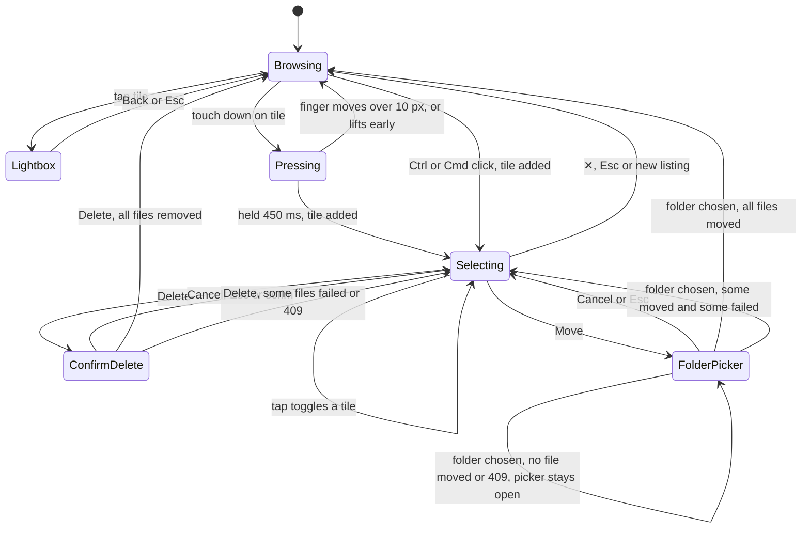
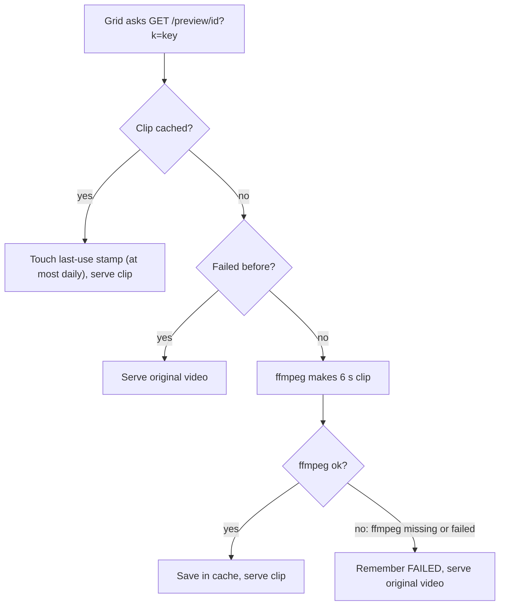
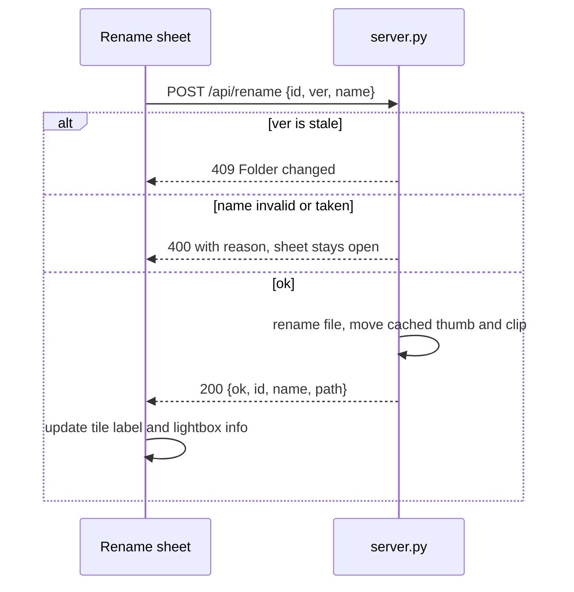

# Civit-RV

Civitai-style tile gallery for local images and videos, tuned for iPhone (Safari). Python 3 standard library only (ffmpeg is optional, for thumbnails); the UI is plain HTML/CSS/JS.

```
python3 server.py /path/to/your/media
```

`FOLDER` is the top-level folder (e.g. your MEGA folder). You can open it and any subfolder below it; nothing outside it is ever served, moved or deleted.

The server listens on `0.0.0.0:8765` (constants at the top of `server.py`) and prints its LAN address, e.g. http://192.168.0.33:8765. Use Safari on iPhone: Chrome/Brave can't play HEVC video.

## Features
- Infinite scroll grid (4, 5 or 6 columns via the column button, 2px gaps on mobile); landscape media spans 2 columns
- Thumbnails and video posters generated with ffmpeg (falls back to originals without ffmpeg)
- Video tiles play a short silent preview clip (about 6 s, 480 px wide, made once with ffmpeg) instead of the original; the lightbox still plays the original, always opened muted (use the controls to unmute). Clips load only near the viewport
- Fast repeat visits: thumbnail, clip and media links are keyed on the file (`k=<mtime>-<size>`) and cached for a year, so they survive restarts and rescans; files also send `Last-Modified` and answer `304`
- Thumbnails and clips for the current folder are generated in the background after a scan; the lightbox shows the thumbnail while the full image loads and preloads the neighbours
- Speed slider (seconds per grid row, from 10 s down to about 1.5 s)
- Rename from the lightbox: edit the name (extension fixed); refused for names that clash (case-insensitive), are empty, have forbidden characters or are too long
- Report sheet (header button): cache size and age, clips still missing, failures, folder totals and this page's load stats
- Lightbox with arrow keys / Esc, Back, Delete (permanent, after a confirmation), Move and Rename
- Multi-select: long-press a tile (touch) or Ctrl/⌘-click (desktop), then tap to add or remove tiles. Move, Delete or Back for the whole selection; one confirmation for deletes. See [Multi-select](#multi-select)
- Search, kind filter, sort, random order, auto-scroll; your choices are remembered per device
- Folder navigator: breadcrumbs, subfolder counts, tap a folder to go into it, "Open here" for the folder shown, tap `MEGA` to go back to the top. Only the folder's own files are shown (not its subfolders'). Move uses the same navigator, so any folder under the top-level folder is a valid destination
- The last folder is remembered across restarts
- Share button in the lightbox; see [Share](#share)
- Dark theme, iOS meta tags, safe-area padding for the notch / Dynamic Island

## Multi-select
Long-press a tile for about 0.45 s (or Ctrl/⌘-click on desktop) to start selecting. Selected tiles get a spinning rainbow ring and the header turns into `✕ · N selected · Move · Delete`. While selecting, a tap toggles a tile and never opens the lightbox. Only `✕` or Esc clears it by hand (a new listing, or a finished action with nothing left selected, also ends it).

> **Warning: Delete is permanent.** Files are removed from disk and cannot be restored. An old `.trash` folder from earlier versions is no longer used; you can delete it by hand.



If some files fail, the ones that worked disappear from the grid, the failed ones stay selected and a toast says why. If the folder was rescanned or changed (stale `ver`, HTTP 409), nothing is touched and the selection is kept.

## Cache and previews
Thumbnails and preview clips live outside the media folder, in `~/.cache/civit-rv` (`thumbs/` and `previews/`; `XDG_CACHE_HOME` is honoured). A file's modified time is its last-use stamp. Anything unused for 30 days is deleted at startup and then every 24 h. The old `.cache/thumbs` inside the project is no longer used and can be deleted.



## Rename


## Share
The lightbox always has a **Share** button that opens the iOS/macOS share sheet with the original file (Save to Photos, AirDrop, Messages...). It needs a secure context (HTTPS). When sharing can't work, tapping it shows the reason instead: `Open the https:// address to share` (plain `http://<LAN IP>:8765`; that URL keeps working for browsing), `This browser can't share files` (e.g. Firefox, older browsers), `Too large to share (over 30 MB)`, `This browser can't share this file type`, or `Couldn't load the file to share`. There is no Download fallback. While the file is fetched in the background the button reads `Preparing…` and is disabled. A cancelled share sheet shows nothing; a real error shows `Couldn't share`.

Getting HTTPS uses Tailscale Serve. These steps are manual and done once; the app is not changed and needs no certificates, it stays plain HTTP on port 8765:
1. In the Tailscale admin console, DNS page, enable MagicDNS and HTTPS certificates.
2. In WSL, run `sudo tailscale serve --bg 8765` (proxies HTTPS to the local server).
3. Check with `tailscale serve status`.
4. On the iPhone or Mac, with Tailscale connected, open `https://w11-wsl-ts.<tailnet>.ts.net`.
5. To turn it off: `tailscale serve reset`.

The server accepts POSTs whose `Origin` matches `Host` or `X-Forwarded-Host` (whichever the proxy keeps or sets), so Move, Delete and Rename should work over the HTTPS address; any other origin is still refused with 403. If Move, Delete or Rename show "Forbidden origin" on the https address, report it: the proxy rewrote `Host` without setting `X-Forwarded-Host`.

## Remembered folder
The folder you were in is saved in `state.json` and restored on restart, as long as it is still inside `FOLDER`.

## Tests
```
python3 -m unittest discover -s tests
```

## Files
`server.py` (server), `static/index.html`, `static/style.css`, `static/app.js`, `static/select.js` (UI; `select.js` has multi-select, the batch Move/Delete calls, the Report sheet and the lightbox Share button), `tests/test_server.py`.
