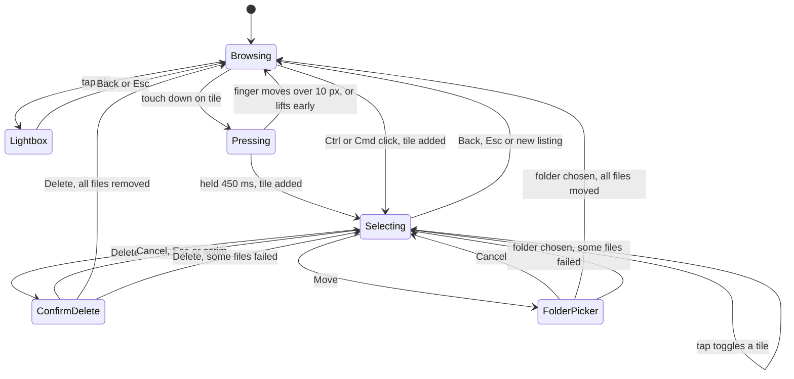

# Civit-RV

Civitai-style tile gallery for local images and videos, tuned for iPhone (Safari). Python 3 standard library only (ffmpeg is optional, for thumbnails); the UI is plain HTML/CSS/JS.

```
python3 server.py /path/to/your/media
```

`FOLDER` is the top-level folder (e.g. your MEGA folder). You can open it and any subfolder below it; nothing outside it is ever served, moved or deleted.

The server listens on `0.0.0.0:8765` (constants at the top of `server.py`) and prints its LAN address, e.g. http://192.168.0.33:8765. Use Safari on iPhone: Chrome/Brave can't play HEVC video.

## Features
- Infinite scroll grid (4 columns, 2px gaps on mobile); landscape media spans 2 columns
- Thumbnails and video posters generated with ffmpeg and cached in `.cache/` (falls back to originals without ffmpeg)
- Videos autoplay muted while on screen and load their source only near the viewport
- Lightbox with arrow keys / Esc, Back, Delete (permanent, after a confirmation) and Move
- Multi-select: long-press a tile (touch) or Ctrl/⌘-click (desktop), then tap to add or remove tiles. Move, Delete or Back for the whole selection; one confirmation for deletes. See [Multi-select](#multi-select)
- Search, kind filter, sort, random order, auto-scroll; your choices are remembered per device
- Folder navigator: breadcrumbs, subfolder counts, tap a folder to go into it, "Open here" for the folder shown, tap `MEGA` to go back to the top. Only the folder's own files are shown (not its subfolders'). Move uses the same navigator, so any folder under the top-level folder is a valid destination
- The last folder is remembered across restarts
- Dark theme, iOS meta tags, safe-area padding for the notch / Dynamic Island

## Multi-select
Long-press a tile for about 0.45 s (or Ctrl/⌘-click on desktop) to start selecting. Selected tiles get a spinning rainbow ring and the header turns into `✕ · N selected · Move · Delete`. While selecting, a tap toggles a tile and never opens the lightbox. Only `✕` or Esc clears the selection.

> **Warning: Delete is permanent.** Files are removed from disk and cannot be restored. An old `.trash` folder from earlier versions is no longer used; you can delete it by hand.



If some files fail, the ones that worked disappear from the grid, the failed ones stay selected and a toast says why. If the folder was rescanned or changed (stale `ver`, HTTP 409), nothing is touched and the selection is kept.

## Remembered folder
The folder you were in is saved in `state.json` and restored on restart, as long as it is still inside `FOLDER`.

## Tests
```
python3 -m unittest discover -s tests
```

## Files
`server.py` (server), `static/index.html`, `static/style.css`, `static/app.js`, `static/select.js` (UI; `select.js` has multi-select and the batch Move/Delete calls), `tests/test_server.py`.
