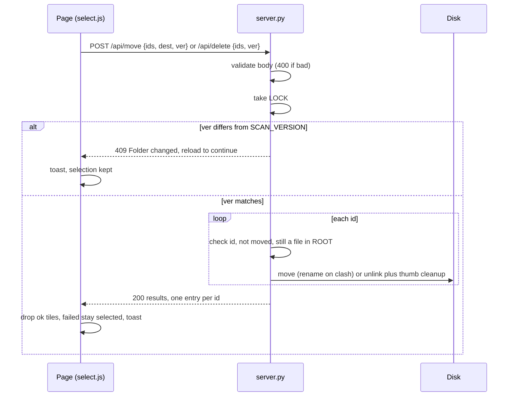
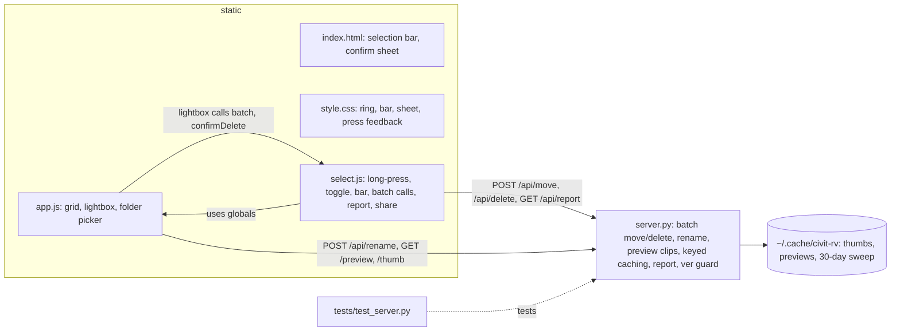

# Session summary: Civit-RV

## Goal
Show local images/videos as tiles like civitai.com, loading more on scroll. Mainly used from an iPhone over the LAN.

## Layout
- `server.py`: `ThreadingHTTPServer`; scans only the current folder's own files (not recursive, skips dotfiles) for jpg/jpeg/png/gif/webp/avif/bmp and mp4/webm/mov/m4v/mkv.
  - GET `/` UI; `/static/*`; `/api/items?offset&limit&sort&seed&kind&q` (sort: newest|oldest|name|size|random); `/media/<id>` (Range support, traversal check); `/thumb/<id>` (ffmpeg JPEG, falls back to the original image); `/preview/<id>` (video only, 6 s silent 480 px H.264 clip, falls back to the original video; 404 for non-videos)
  - Caches live in `~/.cache/civit-rv/{thumbs,previews}` (`XDG_CACHE_HOME` honoured), outside the media folder. File mtime = last use (touched on serve, at most daily); swept at startup and every 24 h for files unused 30 days. Old project `.cache/thumbs` is unused. Failed thumbs/clips are remembered in memory (`FAILED`) so ffmpeg is not retried; `/api/items` items carry `k`
  - `k=<mtime ms>-<size>` on `/media`, `/thumb`, `/preview`: when it matches the file, the response is `Cache-Control: public, max-age=31536000, immutable`; a `k` that does not match the file now at that id (ids are list positions and change on rescan) gets 404 `Cache-Control: no-store` and no file bytes. Without `k`, and for fallbacks to originals, the response is `no-cache`. All files send `Last-Modified`; `If-Modified-Since` (without `Range`) gets 304. css/js are `no-cache`, png/svg/ico `max-age=3600`
  - GET `/api/info`, `/api/rescan`, `/api/folders?path=` (subfolders of `path` + breadcrumbs + counts; default = parent of current), `/api/folder?path=` (open a folder)
  - POST `/api/move` JSON `{ids, dest, ver}` (dest = any folder path under the top-level folder) and `/api/delete` JSON `{ids, ver}`. Both return 200 `{results: [{id, ok, error?}]}` (one entry per id); 409 if `ver` is not the current scan version (nothing touched); 400 for a bad `dest`, empty/non-list `ids` or missing `ver`; 415 unless `Content-Type` is `application/json`; 403 if an `Origin` header is present and does not match `Host` (CSRF guard). Symlinked files are refused per file (`Symlinks are not supported`). Delete is permanent (`os.unlink` plus the cached thumbnail and clip); the old `?id=` form is gone
  - POST `/api/rename` JSON `{id, ver, name}` (`name` = stem, extension kept). 200 `{ok, id, name, path}` (same name = no-op 200); 409 `Folder changed — reload to continue` on stale `ver`; 404 `File not found`; 400 for non-int `id`/`ver` or non-string `name` (`id and ver must be integers and name a string`), `Symlinks are not supported`, `Name can't be empty`, `Name can't contain / \ : * ? " < > |`, `Name can't start with a dot`, `Name is too long` (over 255 bytes), `A file named X already exists` (case-insensitive, own case-only change allowed), `Could not rename file: ...`. Same 415/403 guards as move/delete. Cached thumb and clip are renamed along with the file
  - GET `/api/report` (`Cache-Control: no-cache`): `thumbs` and `previews` = `{files, bytes, oldest_use}` (`null` if the folder is missing; `oldest_use` = epoch seconds); `legacy_thumbs` same shape for the old `.cache/thumbs`; `failed` = `{thumb, preview}` counts this process; `folder` = `{images, videos, bytes, videos_without_clip}` for the current folder; `max_age_days` (30). The page adds its own load/bytes/cache-hit stats from browser timing
  - `BASE` = top-level folder from the CLI (never left); `ROOT` = folder currently shown. Paths from the client are `/`-separated, relative to BASE, validated by `resolve_rel` (no hidden parts, no `..`, no symlink escape)
  - Current folder persisted in `state.json`, restored on restart if still inside BASE
- `static/index.html` + `style.css` + `app.js` + `select.js`: the UI (`select.js` = multi-select, batch calls, delete confirmation sheet; loaded after `app.js`). css/js are served uncached; images/icons are cached. Sort/filter/random/speed live in `localStorage`.
- `tests/test_server.py`: stdlib unittest (`python3 -m unittest discover -s tests`).

## Run
`python3 server.py /path/to/MEGA` (the folder is the top-level/root; systemd unit `/etc/systemd/system/app-civitai.service` runs it). Host/port are constants in `server.py`.

## Branches
`main` is the branch running on WSL. Multi-select is merged. The speed/UX features (hover previews, cache keys, 4/5/6 columns, rename, cache report) are described in the sections above and README.

## Batch request

## Files

## Known limitations / ideas
- Item ids are indexes into the scan list, so they still shift after Rescan/folder change. The `ver` guard stops a stale page from acting on the wrong file (409, nothing touched), but the user must reload to continue. `SCAN_VERSION` starts at a per-process-unique value (so a restart never reuses a `ver`), `ROOT`/`ITEMS`/`SCAN_VERSION` change together under `LOCK`, and the client stops loading more pages (red toast) when a page reports a different `ver`, so old selected tiles keep the old `ver`. Idea: key items by path hash.
- Delete is permanent, no undo.
- Selection is not kept across a new listing (folder change, search, filter, sort, Rescan).
- No authentication: anyone on the LAN can view, move and delete (a token feature was built and removed on request).
- Failure memory (`FAILED`) is in memory only: a restart retries failed thumbs/clips once.
- First visit to a folder pays clip encoding (background warm helps; ~0.35 s per clip on the test file).
- The `k` key is `mtime-size`: two different files with identical mtime and size at the same id would collide (practically only on in-place edits that keep both).
- iCloud online-only files (`st_size > 0`, `st_blocks == 0`): `/thumb` and `/preview` start a background download (deduped, 4 at a time, still runs after the request gives up) and wait 10 s (`FETCH_WAIT`); if not there yet they answer 503 `{"error": "downloading"}` (`no-store`, `Retry-After: 10`), never touching ffmpeg or `FAILED`; the tile stays empty until a later view. Warm-up skips such files; ffmpeg timeouts are not remembered as failed.
- Share (`select.js`, `prepareShare`): the original is prefetched as a Blob (one at a time, aborted on navigate/close) so the click can call `navigator.share` synchronously. The lightbox shows that same Blob (`URL.createObjectURL`, revoked in `cancelShare`) instead of requesting `/media` again, so there is one download per view; on prefetch failure it falls back to streaming `/media`. Consequence: images and videos up to `SHARE_MAX` on share-capable browsers appear/start only once fully loaded (images show the thumb meanwhile, videos the poster); for iCloud online-only files that prefetch triggers the download. Larger files show `Too large to share` plus Download. Share needs a secure context and a browser that supports file sharing (`navigator.share`/`canShare`; Firefox gets Download): use HTTPS via `tailscale serve --bg 8765` (manual, see README); plain `http://<LAN IP>:8765` gets Download.
- Origin guard (`origin_allowed`): no `Origin` is accepted; otherwise its netloc must equal `Host` or `X-Forwarded-Host`, else 403 `Forbidden origin` (`Origin: null` never matches). The forwarded header only widens the allowed set.
- ffmpeg thumbnails may ignore EXIF rotation on some builds.
- Ideas: AI-generation metadata (A1111/ComfyUI PNG prompts) in the lightbox, favorites/tags, filesystem watcher instead of Rescan.
