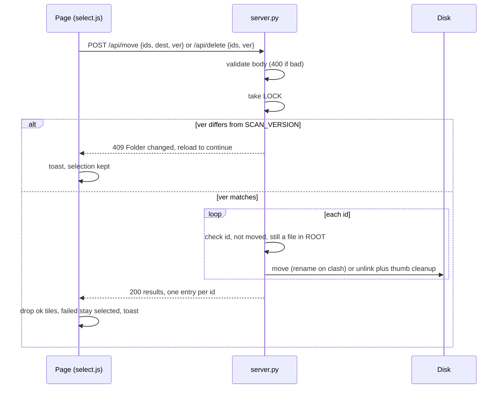
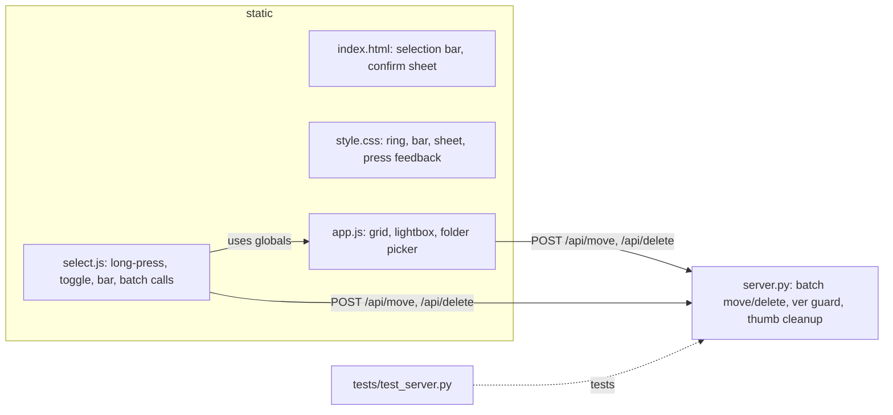

# Session summary: Civit-RV

## Goal
Show local images/videos as tiles like civitai.com, loading more on scroll. Mainly used from an iPhone over the LAN.

## Layout
- `server.py`: `ThreadingHTTPServer`; scans only the current folder's own files (not recursive, skips dotfiles) for jpg/jpeg/png/gif/webp/avif/bmp and mp4/webm/mov/m4v/mkv.
  - GET `/` UI; `/static/*`; `/api/items?offset&limit&sort&seed&kind&q` (sort: newest|oldest|name|size|random); `/media/<id>` (Range support, traversal check); `/thumb/<id>` (ffmpeg JPEG, cached in `.cache/thumbs`, falls back to the original image)
  - GET `/api/info`, `/api/rescan`, `/api/folders?path=` (subfolders of `path` + breadcrumbs + counts; default = parent of current), `/api/folder?path=` (open a folder)
  - POST `/api/move` JSON `{ids, dest, ver}` (dest = any folder path under the top-level folder) and `/api/delete` JSON `{ids, ver}`. Both return 200 `{results: [{id, ok, error?}]}` (one entry per id); 409 if `ver` is not the current scan version (nothing touched); 400 for a bad `dest`, empty/non-list `ids` or missing `ver`. Delete is permanent (`os.unlink` plus the cached thumbnail); the old `?id=` form is gone
  - `BASE` = top-level folder from the CLI (never left); `ROOT` = folder currently shown. Paths from the client are `/`-separated, relative to BASE, validated by `resolve_rel` (no hidden parts, no `..`, no symlink escape)
  - Current folder persisted in `state.json`, restored on restart if still inside BASE
- `static/index.html` + `style.css` + `app.js` + `select.js`: the UI (`select.js` = multi-select, batch calls, delete confirmation sheet; loaded after `app.js`). css/js are served uncached; images/icons are cached. Sort/filter/random/speed live in `localStorage`.
- `tests/test_server.py`: stdlib unittest (`python3 -m unittest discover -s tests`).

## Run
`python3 server.py /path/to/MEGA` (the folder is the top-level/root; systemd unit `/etc/systemd/system/app-civitai.service` runs it). Host/port are constants in `server.py`.

## Branches
`main` is the branch running on WSL. Multi-select lives on `feature/multiselect` until reviewed and merged.

## Batch request

## Files

## Known limitations / ideas
- Item ids are indexes into the scan list, so they still shift after Rescan/folder change. The `ver` guard now stops a stale page from acting on the wrong file (409, nothing touched), but the user must reload to continue. Idea: key items by path hash.
- Delete is permanent, no undo.
- Selection is not kept across a new listing (folder change, search, filter, sort, Rescan).
- No authentication: anyone on the LAN can view, move and delete (a token feature was built and removed on request).
- ffmpeg thumbnails may ignore EXIF rotation on some builds.
- Ideas: AI-generation metadata (A1111/ComfyUI PNG prompts) in the lightbox, favorites/tags, filesystem watcher instead of Rescan.
