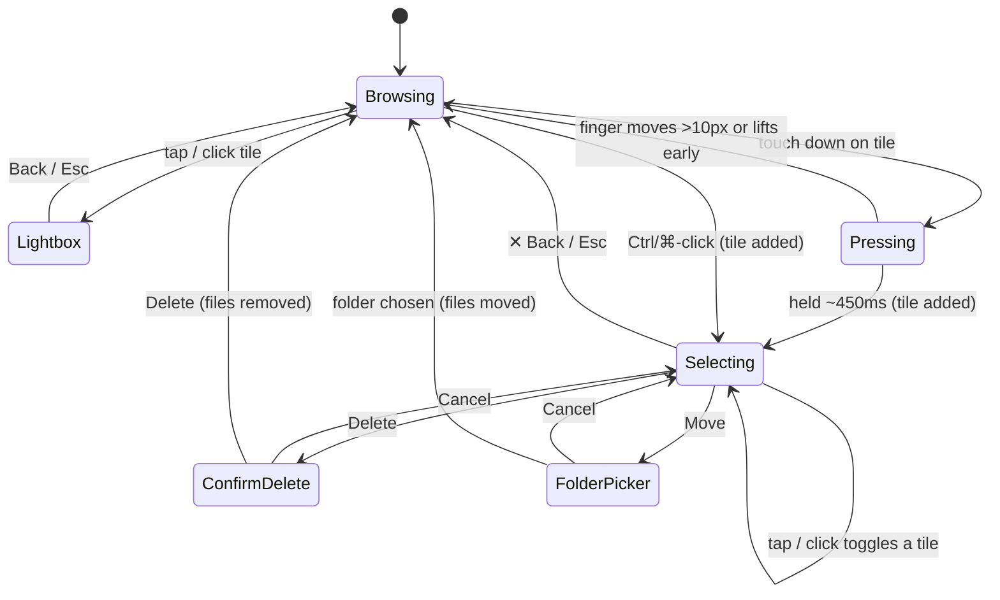
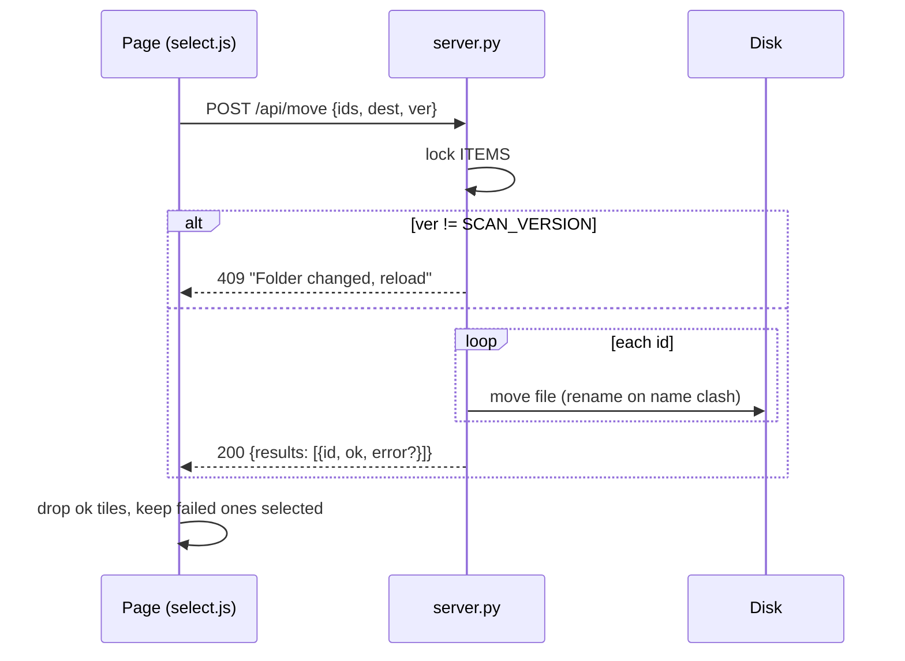
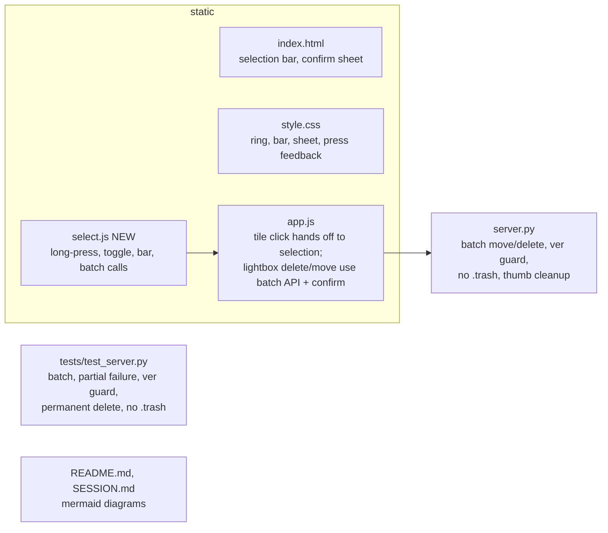

# Multi-select: move and delete many files at once

Date: 2026-11-13 · Status: approved, implemented on feature/multiselect (pending Rafael's review/merge) · Branch: `feature/multiselect`

## Why

Rafael sorts large folders of AI-generated images and videos, mostly from an iPhone and sometimes from a desktop browser. Today Move and Delete work on one file at a time, from the lightbox. That is slow when 30 files need to go to the same folder. The goal is Finder/Explorer-style selection in the grid, followed by one Move or Delete for the whole selection.

## Goals

- Select a handful of files (typically up to 30-50; images and videos mixed) straight from the grid.
- Two ways to start a selection:
  - **Touch (iPhone Safari):** long-press a tile.
  - **Desktop:** Ctrl-click or ⌘-click a tile.
- After the first tile, a plain tap or click adds or removes a tile.
- Three actions: **Move** to another folder, **Delete** permanently, **Back** to clear the selection.
- Selected tiles get a spinning rainbow ring (the "Neon spin" style). It should look gorgeous and polished.
- **Delete becomes permanent everywhere,** including the lightbox's single-file Delete. The `.trash` logic is removed.

## Non-goals

- Select all, Shift-click range selection, drag or swipe to select.
- Undo for deletes.
- Keeping a selection across a folder change, Rescan, search, filter or sort.
- Removing the existing `.trash` folder from disk. That is left to Rafael.

## Anti-goals: these would be failures even if everything else works

- **Losing a selection by accident.** Only Back or Esc clears it.
- **Deleting a file that wasn't selected.** For example, ids shifting after a rescan and pointing at different files.
- A long-press that also opens the lightbox, selects text, or pops up the iOS callout menu.
- A scroll gesture that starts a selection.

## Decided with Rafael

| Topic | Decision |
|---|---|
| Starting a selection | Long-press about 450 ms on touch; Ctrl/⌘-click on desktop |
| While selecting | Tap or click toggles a tile and never opens the lightbox |
| Unselecting | Removes only that tile. At 0 selected, the bar stays open until Back is pressed |
| Clearing | Only Back, or Esc on desktop |
| Look of a selected tile | **A · Neon spin**: thin (3px) rotating rainbow ring; photo untouched |
| Action bar | **2 · Header swap**: the header turns into `✕ · N selected · Move · Delete` |
| Delete | Permanent. Confirmation sheet first ("Delete 12 files?" plus a small stack of thumbnails and "They'll be deleted for good. This can't be undone.") |
| Lightbox Delete | Also permanent, also behind the confirmation sheet ("Delete 1 file?") |
| Server approach | Batch actions (option 2 below) |
| Deploy | Stop after build and test on `feature/multiselect`. Rafael reviews, merges, and restarts the service |
| Docs | README and SESSION.md updated, with mermaid diagrams |

The approved mockup lives in `.superpowers/brainstorm/` (not committed). Reference file: `selection-look-v2.html`.

## Approaches considered

1. **Page loops over the existing single-file Move and Delete actions.** The server barely changes. It was rejected because it sends 40 separate requests. If anything rescans between them (for example Rescan pressed on another device), the remaining ids point at different files, and with permanent delete that means deleting the wrong file.
2. **Batch Move and Delete actions on the server (chosen).** One request carries the whole selection. The server processes it under one lock and reports a result per file. The lightbox uses the same actions with a list of one, so there is a single code path to maintain and test.

## Design

### How the selection behaves

If some files fail, the ones that succeeded disappear from the grid, the failed ones **stay selected**, a toast says how many failed and why, and the page remains in Selecting.

### While selecting

- The header is replaced by the selection bar: `✕` (Back), the count "N selected", **Move**, **Delete**. Move and Delete are disabled at 0 selected. The bar has a rainbow bottom border, and it stays sticky at the top like the header, with the same safe-area padding for the notch / Dynamic Island.
- Feedback after an action: a success toast ("Moved 12 files", "Deleted 12 files") in a neutral style. The existing red toast is kept for errors and partial failures. This is the builder's call, made in this doc.
- Search, filter, sort, Random, Folder and Rescan are therefore not reachable. Each of them reloads the grid, which would invalidate the selection.
- Auto-scroll pauses and resumes after the selection ends if it was on.
- Infinite scroll keeps working. Newly loaded tiles can be selected too.
- The lightbox cannot be opened while selecting.

### Long-press details (iPhone Safari)

- Pointer events on the grid. Pointer-down on a tile starts a 450 ms timer, and the tile sinks slightly (scale about 0.94, dimmed) as feedback.
- Moving more than 10 px, lifting the finger, or `pointercancel` (iOS fires it when a scroll begins) cancels the press.
- When the timer fires, the tile is selected and the click event that follows the release is swallowed, so the lightbox does not open.
- Tiles get `user-select: none`, `-webkit-touch-callout: none`, `draggable=false` on images, and `contextmenu` prevented on the grid. Holding a tile must never select text, start an image drag, or show the iOS menu, including on videos.
- **macOS Ctrl-click:** on a Mac, Ctrl-click fires `contextmenu` instead of `click`. A `contextmenu` event with `ctrlKey` on a tile is therefore treated as the selecting click, and the menu is suppressed. The toggle must happen exactly once, whichever event arrives.
- `navigator.vibrate` is called when available (Android). iOS Safari has no haptics API, so the sink animation and ring are the feedback there.

### Rainbow ring ("Neon spin")

- A `::before` pseudo-element on the tile: a rotating `conic-gradient` masked down to a 3px ring, with `border-radius` inherited from the tile.
- The angle is a registered custom property (`@property --a { syntax: '<angle>' }`) animated from 0 to 360deg over about 2.6s, linear, infinite. Supported in Safari 16.4+ and Chrome.
- **Pitfall found in the mockup:** the gradient must be declared on the element that animates `--a`, or on `*`, and not as a variable on `:root`. A `:root` variable resolves `var(--a)` once, so the ring stops spinning.
- The ring fades and scales in (`opacity` and `transform`, about 0.2s) when a tile is selected. The blue hover outline is not shown on selected tiles.
- `prefers-reduced-motion`: the existing global rule already shortens animations, so the ring shows as a static rainbow.
- Colours: `#ff2d55, #ff9500, #ffd60a, #30d158, #64d2ff, #5e5ce6, #bf5af2`, back to the start.

### Delete confirmation sheet

- A modal sheet. On phones it rises from the bottom; on desktop it is centred. A blurred scrim covers the page behind it.
- Contents: a fanned stack of up to 4 selected thumbnails plus "+N", the title "Delete N files?", the line "They'll be deleted for good. This can't be undone.", and Cancel / Delete (red) buttons.
- Esc or tapping the scrim cancels. The default focus is Cancel.

### Move

- Reuses the existing folder navigator (`pickFolder`), titled "Move N files". Cancel returns to Selecting with the selection intact.

### Server: batch actions

- `POST /api/move` with JSON body `{"ids": [3, 7, 12], "dest": "portraits/best", "ver": 5}`.
- `POST /api/delete` with JSON body `{"ids": [3, 7, 12], "ver": 5}`.
- **Scan-version guard:** the page already receives `ver` with every items page. The server rejects the whole request with 409 if `ver` is not the current `SCAN_VERSION`. A rescan or folder change in between, from any device, therefore can never point an id at a different file. The page shows the toast "Folder changed — reload to continue" and keeps the selection, so nothing happens silently.
- The whole batch is processed while holding `LOCK`, so a scan cannot interleave with it.
- Per-file checks are unchanged from today: id in range, not already moved, still a file inside `ROOT`, and the destination is not the file's current folder. Name clashes in the destination get `_1`, `_2`, ... suffixes.
- Each file gets an entry in `results`: `{"id": 3, "ok": true}` or `{"id": 7, "ok": false, "error": "Already moved"}`. The HTTP status is 200 even when some files fail. A bad destination, an empty or non-list `ids`, or a missing `ver` gives 400 for the whole request.
- Delete uses `os.unlink`. It also removes that file's cached thumbnail in `.cache/thumbs`, so nothing of a deleted file is left behind.
- The single-file `?id=` query form of both endpoints is removed. The lightbox sends `{"ids": [id], "ver": ver}`.
- One log line per file (`Moved a -> b` / `Deleted a`), plus a summary line per request.

### Files touched

## Constraints

- Python standard library only. Plain HTML, CSS and JS: no frameworks, no build step, no new dependencies.
- The main target is iPhone Safari over the LAN; desktop Chrome and Safari must work too.
- Nothing outside `BASE` is ever touched. Existing path validation (`resolve_rel`) still applies to `dest`.
- `css` and `js` are served uncached, so changes show on reload.

## Test plan

- **Server (unittest):**
  - Batch move of several files, including mixed images and videos.
  - Batch delete is permanent: the file is gone and no `.trash` folder is created.
  - Partial failure: one id already moved, one out of range, and the others still succeed.
  - A stale `ver` gives 409 and nothing is touched.
  - Bad destination, empty `ids`, or non-numeric `ids` give 400.
  - The cached thumbnail is removed on delete.
  - The existing `test_delete_goes_to_trash` and `test_delete_trash_is_at_base` are replaced by permanent-delete tests.
- **Browser (headless Chromium via Playwright, scratch script, not committed):**
  - Ctrl-click enters selection, a plain click toggles, Esc clears, and the ring's angle changes over time.
  - A simulated long-press (pointer down, wait, up) selects without opening the lightbox.
  - A pointer move during the press cancels it.
  - The confirm sheet appears, and Cancel keeps the selection.
- **Manual on iPhone:** Rafael checks the long-press feel, that scrolling never selects, and that no callout menu appears.

## Docs

- **README:** a Features entry for multi-select, the delete wording changed to permanent, and a mermaid state diagram of the selection.
- **SESSION.md:** the updated API lines, the `.trash` mention removed, the ver guard noted under the known limitations, a mermaid sequence diagram of the batch request, and the stale `feature-multiselect` branch line removed (the branch was deleted on 2026-11-13).

## Left to the builder

- Exact animation timings and easing, and the bar's spacing and typography, within the mockup's look.
- How `select.js` and `app.js` share state (for example a small shared object on `window`, or `app.js` exposing hooks).
- Toast wording beyond the messages given above.
